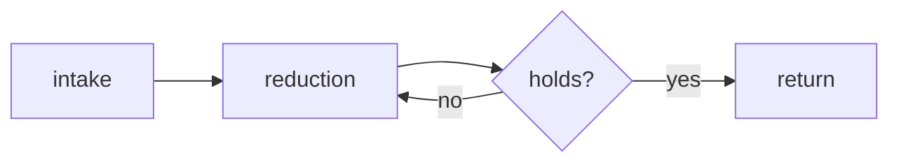

In the same way that a well-designed object reveals how it wants to be held,
this product reveals how it wants to be used before anyone reads a word. That is
the whole ambition: cognition that shows itself in the surface.

## What it is

It began as an internal instrument and stayed one. The shape came from use, not
from specification — every part that survived is a part someone reached for more
than once. What follows is a description of that shape.

The instrument does one thing: it maps a question onto the passages that answer
it. It does not summarize. A summary asks you to trust a voice you cannot check.

## How it works

Three movements, in order. First the intake, where material arrives unformed.
Then the reduction, where it is made small enough to hold. Finally the return,
where it goes back out into the same world that produced it.



### What the movements cost

Each movement has a price, and the price is not hidden.

1. Intake takes time proportional to the shelf.
2. Reduction throws away everything that does not answer.
3. Return is the only step the reader sees.

### What it refuses

- It refuses to invent a passage.
- It refuses to average two authors into one voice.
- It refuses to return a page number it did not read.

## A passage it returned

The instrument exists because this problem is old and already named.

> The law of the instrument: give a small knowledge, and things look uniform,
> give a large one, and they look varied.

> — Warren Weaver, *Recent Contributions to the Mathematical Theory of Communication*

### The same claim, sharper

> We can prevent or reduce identifier collisions by adding information about the
> namespace, the domain from which the names or identifiers are selected.

> — Robert J. Glushko, *The Discipline of Organizing*, §3.4.3.4

## Reading the output

A result is a passage, a source, and a score. The score is not truth; it is
proximity. Two passages can score alike and say opposite things.

Inline detail appears like `librarian.search(query)` in a sentence, and a command
looks like `librarian index --rebuild`. Both are set apart from prose; neither
competes with it.

```python
result = librarian.search("delay tolerant routing", k=5)
for passage in result.passages:
    print(passage.book_title, passage.score)
```

```console
$ librarian index --rebuild
indexed 412 books in 9m12s
```

A value you supply yourself is written `--shelf <path>` and is set apart from the
instruction, so the two never read as one thing.

## Notes


The index is rebuilt on write. A search during a rebuild returns the previous
index, not a partial one.



Ask in the language of the book, not the language of the question.



A high score on a short passage is weaker evidence than a middling score on a
long one. Length is not noise.


## Status

Working, with the usual caveats. Nothing here asks for attention it has not
earned, and nothing claims to be finished.

| Surface | State | Since |
| --- | --- | --- |
| Search | working | 2026-08 |
| Index rebuild | working | 2026-09 |
| Multi-shelf | not started | — |

Press <kbd>⌘</kbd> + <kbd>K</kbd> to open the query field.

---

Cover art is reserved for this product; the default cover ships first.
