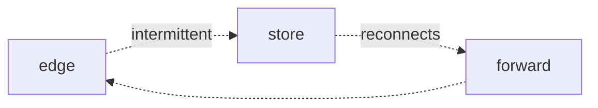

The first thing to notice is that the constraint is not an obstacle to the
design — it is the design. Everything that works here works because something
else was ruled out first.

## The shape of the problem

We tend to describe this as a gap to be closed. Framed that way, every answer
looks like more: more bandwidth, more storage, more computation. The other
framing asks what becomes possible when the gap is permanent and acknowledged.

## What changes

Once the gap is treated as given, the interesting decisions move earlier. You
stop asking how to move the data and start asking what has to be true before the
data is worth moving at all.

## Where this leaves us

Not with a solution, but with a better question. That is usually the honest
place to stop.
