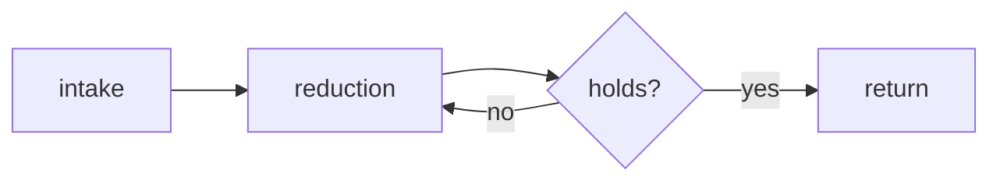

In the same way that a well-designed object reveals how it wants to be held,
this product reveals how it wants to be used before anyone reads a word. That is
the whole ambition: cognition that shows itself in the surface.

## What it is

It began as an internal instrument and stayed one. The shape came from use, not
from specification — every part that survived is a part someone reached for more
than once. What follows is a description of that shape.

## How it works

Three movements, in order. First the intake, where material arrives unformed.
Then the reduction, where it is made small enough to hold. Finally the return,
where it goes back out into the same world that produced it.

## Status

Working, with the usual caveats. Nothing here asks for attention it has not
earned, and nothing claims to be finished.
